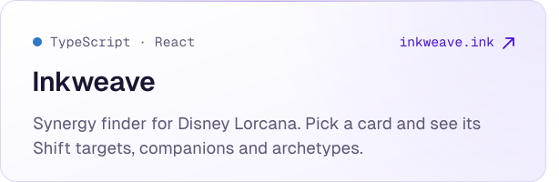
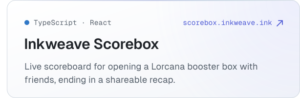
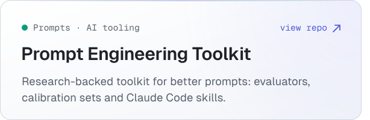
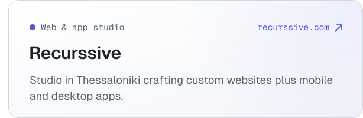

<picture>
  <source media="(prefers-color-scheme: dark)" srcset="./assets/header-dark.svg">
  <source media="(prefers-color-scheme: light)" srcset="./assets/header-light.svg">
  
</picture>

### Now building

  <a href="https://inkweave.ink"><picture><source media="(prefers-color-scheme: dark)" srcset="./assets/card-inkweave-dark.svg"></picture></a><a href="https://scorebox.inkweave.ink"><picture><source media="(prefers-color-scheme: dark)" srcset="./assets/card-scorebox-dark.svg"></picture></a>

  <a href="https://github.com/Doberjohn/prompt-engineering-toolkit"><picture><source media="(prefers-color-scheme: dark)" srcset="./assets/card-prompt-toolkit-dark.svg"></picture></a><a href="https://recurssive.com"><picture><source media="(prefers-color-scheme: dark)" srcset="./assets/card-recurssive-dark.svg"></picture></a>

### Stack

<picture>
  <source media="(prefers-color-scheme: dark)" srcset="https://skillicons.dev/icons?i=ts,js,react,html,css,python&theme=dark">
  
</picture>

### Contributions

<picture>
  <source media="(prefers-color-scheme: dark)" srcset="https://raw.githubusercontent.com/Doberjohn/Doberjohn/output/snake-dark.svg">
  
</picture>

 

  
    <a href="https://recurssive.com">recurssive.com</a> &nbsp;·&nbsp;
    <a href="https://inkweave.ink">inkweave.ink</a> &nbsp;·&nbsp;
    <a href="https://app.daily.dev/johnfanidis">daily.dev</a>
  

